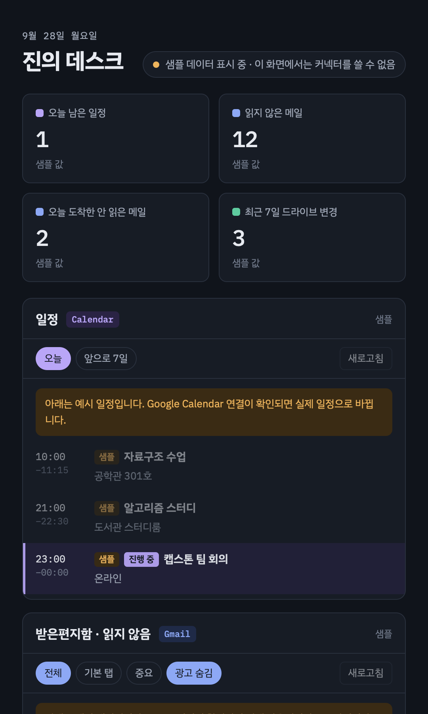
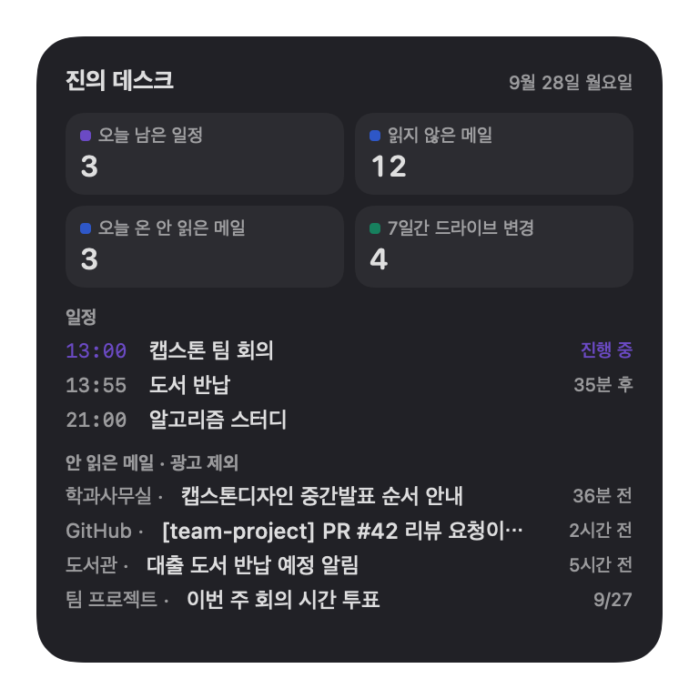
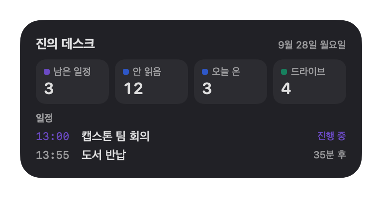
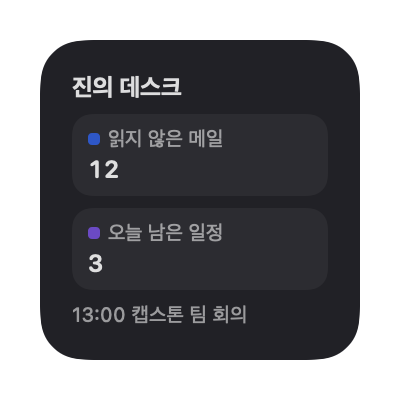

# 진의 데스크 (Jin's Desk)

Gmail · Google Calendar · Google Drive를 한 화면에 모아 보는 **macOS 개인 대시보드 앱과 WidgetKit 위젯**입니다.
Claude로 만든 HTML 대시보드(claude.ai Artifact)를 맥 앱으로 옮기면서, 커넥터 대신 Google API에 직접 연결하고 진짜 macOS 위젯까지 붙였습니다.

> A personal macOS dashboard (Swift + WKWebView) with a WidgetKit widget, showing unread Gmail, today's calendar and recent Drive files. Built with `swiftc` only — no Xcode project. UI is Korean.

<p align="center">
  
  &nbsp;
  
</p>
<p align="center">
  
  
</p>

<sub>모든 그림은 지어낸 샘플 데이터입니다. 대시보드는 앱의 `--snapshot`으로 찍었고, 위젯 그림은 `tools/widget-snapshot.sh`가 위젯 코드를 그대로 써서 그립니다. 실제 바탕화면에서는 macOS가 배경과 흑백 전환을 입힙니다.</sub>

## 기능

- **대시보드 창**: 오늘 남은 일정, 읽지 않은 메일, 최근 드라이브 파일을 한 화면에. ⌃⌥J로 열고 닫기, Dock·⌘Tab 지원
- **WidgetKit 위젯(소·중·대)**: 시스템 위젯처럼 흑백·색 전환, 위젯 편집, 미션 컨트롤을 macOS가 처리
- **광고 숨김**: 프로모션·소셜 분류와 제목의 `(광고)` 표시를 걸러서 개수와 목록에서 뺌
- **메일 → 캘린더 자동 추가**(기본 꺼짐): 결제일·무료 체험 종료·행사 일시 같은 메일 속 일정을 규칙으로 찾아 캘린더에 추가. 메일 내용은 맥 밖으로 나가지 않음
- **로컬 페이지 호스트**: `pages` 폴더에 HTML을 넣으면 앱 메뉴에서 바로 열 수 있음. 페이지에서 알림·파일·클립보드 같은 맥 기능을 쓸 수 있는 `window.jin` 제공

## 구조

```text
Google API (OAuth, 루프백 + PKCE)
   │
   ▼
JinDesk.app ─────────────────────────────────────────────┐
 ├ Google.swift       인증 · Gmail/Drive/Calendar 호출     │
 │                    (claude.ai 커넥터와 같은 응답 모양)   │
 ├ Bridge.swift       jindesk:// 로 로컬 HTML 서빙          │
 │                    window.claude.use("mcp") 흉내 + window.jin
 ├ main.swift         앱 창 · 메뉴 · 단축키 · 점검 옵션      │
 ├ Feed.swift         위젯용 요약 → widget/data.json        │
 └ MailCalendar.swift 메일에서 일정 찾기 (규칙 6종)          │
                                                          ▼
                             JinDeskWidget.appex (SwiftUI, 샌드박스, data.json 읽기 전용)
```

- **Artifact 코드를 그대로 재사용**: `jin-desk.html`은 원래 claude.ai에서 `window.claude.use("mcp")`로 커넥터를 부르던 페이지입니다. 앱이 같은 API를 흉내 내고 Google 응답을 커넥터와 같은 모양으로 바꿔 주기 때문에, 페이지 코드는 거의 고치지 않고 로컬에서 돌아갑니다.
- **Xcode 프로젝트 없이 위젯 빌드**: `install.sh`가 `swiftc`로 앱과 위젯 확장(`.appex`)을 따로 빌드하고, Info.plist를 만들고, 서명하고, Launch Services에 등록합니다.

## 요구 사항

- macOS 14 이상, **Apple Silicon** (위젯 빌드 대상이 `arm64-apple-macos14.0`)
- Xcode Command Line Tools (`xcode-select --install`)
- 위젯을 쓰려면 키체인에 **Apple Development 인증서**(무료 Apple ID로 만들 수 있음). 없으면 ad-hoc으로 서명되는데, 이 경우 macOS가 위젯 확장 실행을 거부할 수 있습니다.
- 본인 Google Cloud 프로젝트의 OAuth 클라이언트 (아래 참고)

## 설치

```bash
git clone <이 저장소 주소> jin-desk
cd jin-desk
./install.sh
```

`install.sh`가 하는 일:
1. 앱과 위젯을 빌드해 `~/Applications/JinDesk.app`에 설치
2. 대시보드 페이지를 `~/Library/Application Support/JinDesk/pages/`에 복사
3. 로그인할 때 자동으로 실행되고, 죽으면 다시 켜지는 LaunchAgent(`com.jin.desk`) 등록

위젯은 바탕화면에서 오른쪽 클릭 → **위젯 편집** → "진의 데스크"로 추가합니다.

## Google 연결 (처음 한 번)

Gmail 권한은 Google이 "제한된 범위"로 분류해서 공용 클라이언트를 배포하기 어렵습니다. 그래서 **각자 자기 OAuth 클라이언트를 만들어** 씁니다.

1. [Google Cloud Console](https://console.cloud.google.com)에서 새 프로젝트를 만듭니다.
2. API 및 서비스 → 라이브러리에서 **Gmail API, Google Drive API, Google Calendar API**를 사용 설정합니다.
3. OAuth 동의 화면: 사용자 유형 "외부", 테스트 사용자에 본인 계정을 추가합니다.
   - 테스트 상태로 두면 갱신 토큰이 7일 뒤 만료될 수 있습니다. 앱을 "프로덕션"으로 바꾸면 본인은 "확인되지 않은 앱" 경고를 넘기고 계속 쓸 수 있습니다.
4. 사용자 인증 정보 → OAuth 클라이언트 ID → 유형은 **데스크톱 앱**으로 만들고 JSON을 내려받습니다. "웹 애플리케이션"으로 만들면 127.0.0.1 리디렉트가 거부됩니다.
5. 받은 파일을 `~/Library/Application Support/JinDesk/google_client.json`으로 저장합니다.
6. 메뉴 막대 아이콘 오른쪽 클릭 → **Google 계정 연결…** → 브라우저에서 로그인하고 허용합니다.

| 권한 범위 | 쓰는 곳 |
|---|---|
| `gmail.modify` | 메일 읽기, 읽음 표시 (삭제 권한 없음) |
| `drive.metadata.readonly` | 최근 파일 목록 (파일 내용은 안 읽음) |
| `calendar.events` | 일정 읽기, 메일에서 찾은 일정 추가 |

토큰은 `~/Library/Application Support/JinDesk/google_token.json`(권한 600)에만 저장되고, 앱 자체는 Google API 말고 다른 서버로 메일·일정·파일 데이터를 보내지 않습니다.

## 보안 참고

- `window.jin`에는 셸 명령 실행(`run`), 파일 읽기·쓰기, CORS 없는 `fetch`가 들어 있습니다. **`pages` 폴더에는 직접 만들었거나 내용을 확인한 HTML만 넣으세요.**
- `window.jin`은 `jindesk://` 메인 프레임에만 주입됩니다. 외부 사이트나 iframe에서는 쓸 수 없습니다.

## 만들면서 막혔던 것

| 증상 | 원인 → 해결 |
|---|---|
| 위젯 확장이 실행되지 않음 (runningboardd `-10814`) | 앱 폴더 이름이 한글이라 Launch Services가 확장 기록을 못 찾음 → 폴더는 `JinDesk.app`으로 두고, 보이는 이름은 `CFBundleDisplayName`으로 |
| 개발자 인증서가 invalid로 나옴 | 키체인에 WWDR G3 중간 인증서가 없었음 → Apple PKI에서 받아 추가 |
| 위젯 확장이 시작하자마자 SIGTRAP | 앱 확장의 시작 함수가 없었음 → 링커에 `-e _NSExtensionMain` |
| 위젯 다시 그리기 실패 "Bundle version did not match" | 예전 버전 위젯 프로세스가 살아 있었음 → 설치할 때 `pkill -x JinDeskWidget`, 빌드마다 `CFBundleVersion` 올림 |
| Gmail 429 "요청 한도" | 스레드 상세를 한꺼번에 병렬로 받았음 → 동시 요청 4개, 1·2·4초 뒤 재시도, 15초 캐시와 같은 요청 합치기 |
| 안 읽은 메일 수가 늘 201 | `resultSizeEstimate`는 어림값 → 스레드 ID를 500개씩 끝까지 받아 정확히 세고, 센 값은 1분 동안 재사용 |
| 종일 일정이 하루 당겨짐 | 종일 `date`가 `...T00:00:00Z`로 와서 UTC로 읽혔음 → 앞 10자만 떼어 현지 자정으로 해석 |

## 점검 옵션

앱을 두 번째로 실행해 상태를 확인할 수 있습니다. 설정은 바뀌지 않습니다.

```bash
BIN="$HOME/Applications/JinDesk.app/Contents/MacOS/JinDesk"
"$BIN" --page jin-desk.html --eval 'return document.getElementById("statusText").textContent' 5   # 페이지 JS 실행 결과 출력
"$BIN" --page jin-desk.html --snapshot /tmp/desk.png 6                                             # 6초 뒤 화면 저장
"$BIN" --mailcal-test                                                                              # 메일 → 일정 규칙 미리보기 (캘린더에 넣지 않음)
```

`JINDESK_HOME=<폴더>`를 붙이면 설정·토큰 폴더를 따로 써서 격리된 상태로 점검할 수 있습니다.

## 한계

- 화면 글자는 한국어만 지원합니다.
- 기본 캘린더만 읽습니다.
- 메일 → 일정은 규칙 기반이라 형식이 다른 메일은 놓칠 수 있고, 첨부 파일로만 온 `.ics`는 아직 읽지 못합니다.
- 공증(notarization)을 받지 않았으므로 소스를 받아 직접 빌드해서 쓰는 방식입니다.

## 라이선스

[MIT](LICENSE)
